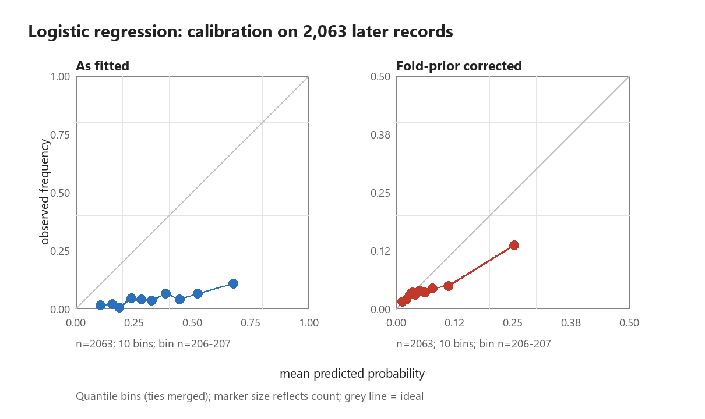
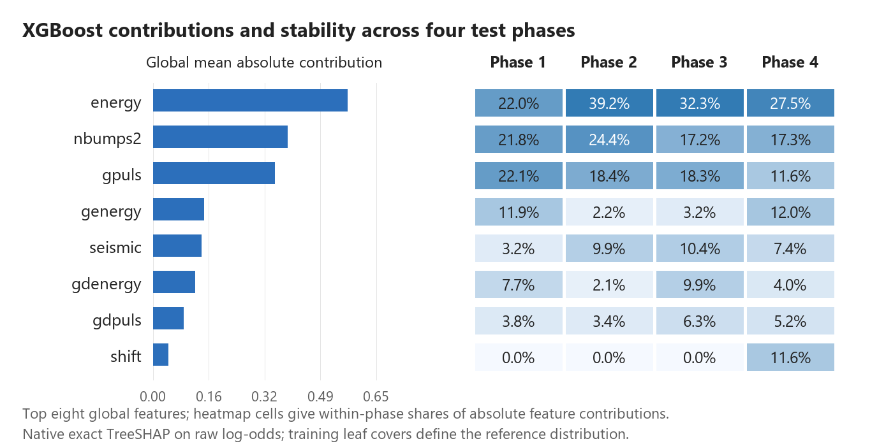

# From Forecast Evaluation to Warning Decisions: A Retrospective Study of Seismic Hazard in Underground Mining

Junjie Yang

Mining Engineering, Fuzhou University

## Abstract

Forecast performance and warning decision value require distinct evidence. This retrospective mining case connects common-cohort forecast assessment with historical threshold transfer on an audited 2,578-row UCI Seismic Bumps mirror. Four record-order test blocks contain 2,063 records and 88 hazardous-shift labels. Matching test records changes the interpretation of random-versus-record-order performance gaps. Training-prior correction reduces logistic-regression expected calibration error from 0.2904 to 0.0271, while Brier skill depends on the stated reference. TreeSHAP and refitted ablations distinguish fitted-model feature use from incremental predictive value. In the decision study, fixed-XGBoost cost-plus-capacity rules selected at missed-shift cost 10 have pooled loss differences of 0.00 to 0.82 units per 100 records versus no alarms. Historical capacity feasibility does not ensure later feasibility: budget rules exceed capacity in 13/16 phase-budget settings; cost-plus-capacity does so in 2/64 phase-budget-cost settings. These are dependent settings with different denominators. Loss, detections and workload together explain the transferred rules, and refitting can change decisions at the same numerical cutoff. The stages share records and are not independent validation studies. Record order is a temporal proxy; costs and capacity are assumptions rather than measured operational outcomes.

Keywords: seismic hazard; forecast evaluation; average precision; warning decisions; threshold transfer; inspection capacity

## 1 Introduction and research objective

Mine-monitoring scores become engineering decisions when a rule selects subsequent shifts for inspection. A model can discriminate between labels, assign more accurate probabilities or rely on interpretable signals without establishing that its selected alerts lower missed-hazard and false-alert loss. The research question is therefore: what forecast evidence and historical selection rules support warning decisions on subsequent mining records under explicit cost and capacity assumptions?

The project answers this question through two complementary analyses. The forecast study compares common test records and separates ranking, probability assessment and feature use. The decision study transfers historically selected rules to later records and measures loss, hazardous-shift coverage and workload. Their joint contribution is a reproducible account of which comparisons support each engineering interpretation. The two analyses retain their own fitting and threshold protocols; one is not a prospective validation of the other.

<!-- page break -->

## 1.1 Relation to mining and decision research

The UCI task concerns a high-energy seismic bump in the next shift, rather than a confirmed rockburst accident [1]. Earlier rule-induction work used working-face-specific monitoring and examined rule transfer [2]. Janusz and colleagues compared expert and sensor information and studied cold start with identified mining sites and structured histories [3]. Those cohorts and forecast targets do not supply a directly comparable performance leaderboard for the present shift-summary mirror. The microseismic monitoring review distinguishes waveform detection and location from forecasting [4]. This study evaluates supplied shift summaries, not event detection from waveforms.

Threshold-choice theory relates scores, operating conditions and expected classification loss [5]. Risk-informed warning identification connects warnings to assessment and response, but its assessment-based Seismic Bumps comparison differs from this study's subsequent-shift event label [6]. Precision-recall interpretation also depends on the evaluation prevalence [7]. These sources motivate explicit comparators; they do not establish that a retrospectively selected rule will work at a new mine or future operating condition.

The report makes three linked empirical contributions: a common-cohort comparison of forecast protocols; a separation of probability improvement, feature use and predictive dependence; and a joint account of historical selection reasons, later loss, capacity excess and refitting. The contribution is an applied evaluation workflow and its mining-case findings. The retained learning, explanation and resampling methods are established methods.

<!-- page break -->

## 2 Data, target and common evaluation records

The official source contains 2,584 records and 170 positive shift labels. An ARFF-to-mirror audit reproduces first-occurrence deduplication without reordering: 6 exact duplicate occurrences, all negative, are removed to yield 2,578 mirror records [1,8]. This verifies the mirror transformation; it does not establish that identical monitoring records could not have represented distinct real shifts. A positive label denotes a bump above 10,000 J in the subsequent eight-hour shift. It is not a catalogue of independent accidents or a measured intervention benefit.

The retained 17-column design contains three hazard assessments (seismic, seismoacoustic, ghazard), four geophone variables, nine seismic-activity variables and shift type. The geophone deviations already use historical summaries supplied with the data. The total count nbumps is omitted from this design; constant energy-band columns remain. Neither timestamps nor working-face identifiers are available to validate cross-row continuity. Recorded order is therefore the stated temporal proxy, not a verified sequence of consecutive shifts from one working face.

Table 1. Shared test census and Stage 2 reference areas. Phases are record blocks, not identified mining sites.

| Phase | Test n | Test + | Test prevalence | Stage 2 ref n | Stage 2 ref + |
| --- | --- | --- | --- | --- | --- |
| 1 | 516 | 36 | 6.98% | 103 | 21 |
| 2 | 515 | 10 | 1.94% | 207 | 1 |
| 3 | 516 | 24 | 4.65% | 310 | 7 |
| 4 | 516 | 18 | 3.49% | 413 | 20 |

The common test cohort has 88/2063 positives (4.27%), distinct from the full-mirror prevalence of 6.59%. The 774-record holdout is wholly within the common test rows and uses a different training cutoff. It was already inspected and is supplementary, overlapping evidence; it is neither an additional independent cohort nor an untouched confirmation set. Sample counts are not added across stages or protocols.

<!-- page break -->

## 3 Two complementary evaluation protocols

LR uses balanced class weights and an L2 penalty of 1. Bagged CART uses 60 unweighted bootstrap trees, depth 6 and minimum leaf size 20. XGBoost uses binary logistic loss, histogram trees, learning rate 0.05, minimum child weight 10 and L2 penalty 5 [9]. The grid is depths 2/3 crossed with 80/160 rounds, with seed 7, two threads and full row/column sampling. Tuning occurs within the supplied training area. Models have deliberately asymmetric weighting and tuning; these are comparisons of retained workflows, not equal-budget algorithm searches.

Table 2. Workflow definitions. Numerical cutoffs and alert counts are comparable only under matched workflows.

| Item | Forecast study (Stage 1) | Decision study (Stage 2) |
| --- | --- | --- |
| Main comparison | Random versus expanding record order on common test rows | Historical A/B/C rules transferred to the same later blocks |
| Model fitting | Outer models refit on supplied training rows | Primary fixed model fits first 80% of outer history |
| Policy reference | Last 20% of history; separate earlier reference model | Last 20% of history; scores from primary fixed model |
| XGBoost choice | Separate training-local searches for outer/reference models | Search inside fitting area; same chosen settings for refitted control |
| Budget cutoff | Exclude boundary score and all ties | Canonical whole-score groups; alerts score >= cutoff |
| Primary transfer | Reference cutoff applied after outer refitting | Freeze model and cutoff; refit on all history as a control |
| Probability scale | LR prior correction for probability evaluation; raw scores for alerts | Raw scores for fixed and refitted alert rules |

Stage 1 uses ten stratified random folds and five seeds; random predictions are restricted to the same 2,063 rows as record-order evaluation. Random AP is the mean of seed-specific AP values. Expanding-window fits train on earlier record blocks. Structured validation makes the tested population and information boundary explicit [10,11]. Matching test rows does not equalize training sizes or remove all protocol differences.

In Stage 2, the first 80% of each historical prefix is the fitting area and the remainder is the policy reference. XGBoost chooses parameters on a further 80/20 split inside the fitting area using AP, with negative Brier score if the inner reference has no positives. A separate refitted control adds the policy-reference rows to fitting, retains the selected parameters and applies the identical numerical threshold. Test labels enter evaluation, not model, parameter or cutoff selection. The Stage 2 plan was locked before its fits, after the dataset had already been examined in Stage 1; the complete study remains exploratory and retrospective.

<!-- page break -->

## 3.1 Probability, explanation and decision definitions

AP groups tied scores before calculating precision increments. The horizontal PR reference is the evaluation cohort prevalence pi [7]. AP-minus-pi is reported as a descriptive difference, not a permutation test or an interval estimate. It neither removes all differences between cohorts nor proves decision value. LR prior correction uses only each outer training fold's unweighted prevalence; CART and XGBoost use their fitted outputs. Ten quantile bins, keeping tied probabilities together, summarize calibration. Brier skill compares squared error with the named historical training-prior or retrospective test-prevalence constant.

Prior-only distribution change is a specific modeling assumption [12]. A probability correction is monotone within a fold; differing fold-specific corrections should not be assumed to preserve pooled rankings. Native exact TreeSHAP decomposes each XGBoost raw log-odds prediction into feature contributions and a bias term, using training leaf covers as its tree-path-dependent reference [13,14]. Refitted group ablations ask a different question: how predictions change after a model is trained without the group. They are not causal feature effects.

Cost-sensitive decisions use the hypothetical loss L = r FN + FP, with false-alert cost 1 [15]. Historical budgets are 1%, 5%, 10% and 20%; r takes 5, 10, 20 and 50. A maximizes whole-group alerts within floor(B Nref). B minimizes reference loss. C minimizes it among capacity-feasible groups. Ties in B/C loss select fewer alerts. Equal scores move together; nonempty partial sets use the lowest included score. No alarms use +infinity and all alarms use -infinity. These conventions can underfill capacity and do not impose later capacity.

An alert represents one candidate shift for inspection. TP is a hazardous shift flagged, FP a non-hazardous shift flagged and FN a hazardous shift missed. Loss per 100 records is L100 = 100(r FN + FP)/N. Its difference from no alarms is Delta Lnone,100 = 100(FP - r TP)/N. Negative differences mean lower hypothetical loss. Excess = max(0, Alerts - floor(B Ntest)); all alerts remain in evaluation, including excess demand. No dispatch, truncation, queueing, separate true-positive inspection cost or accident-severity cost is modeled. Pooled excess sums phase excesses, without cancellation by spare slots elsewhere.

Paired moving-block intervals use 2,000 replicates and block length 32, separately within test phases, without wrapping across endpoints or phase boundaries [16,17]. Both compared methods use the same sampled rows; pooled sampling preserves phase sizes. Intervals condition on saved predictions, fitted rules and the current cohort, and exclude full fitting/tuning/selection uncertainty. The retained loss intervals cover C-A, C-B, secondary B-A and refitted-fixed contrasts. They do not provide ML-minus-no-alarm or ML-minus-direct-grade intervals. No such interval is inferred from a different contrast.

<!-- page break -->

## 4 Forecast evidence on comparable test records

Table 3. AP on 2,063 common test records; prevalence reference pi = 0.0427. AP-minus-pi concerns the record-order column.

| Model | Random AP | Record-order AP | AP minus pi | Random minus order | 95% paired interval |
| --- | --- | --- | --- | --- | --- |
| LR | 0.0953 | 0.0838 | 0.0412 | 0.0114 | [-0.0110, 0.0243] |
| CART | 0.0972 | 0.0784 | 0.0357 | 0.0188 | [0.0064, 0.0323] |
| XGBoost | 0.0995 | 0.0862 | 0.0436 | 0.0133 | [0.0004, 0.0256] |

The interval in the last column belongs to the protocol difference, not to AP-minus-pi. All common-cohort point AP values exceed the prevalence reference; that descriptive observation alone is not a significance test against a random-ranking null. Finite-sample random-order AP and the horizontal PR reference are distinct concepts. No global label permutation is introduced.

Restricting the comparison to common rows reduces the original different-cohort gap by 89.7% for LR, 86.9% for CART. The comparison changes which records contribute to the random score, not its fitted models. Cohort matching establishes evaluation-population sensitivity, while residual differences combine training history, sample size and tuning. Neither attenuation nor the residual is a causal estimate of leakage or drift. The Stage 1 technical report retains the original and matched denominators and the full gap calculation.

Stage-specific XGBoost results further separate ranking from cohort composition: phase 1: AP 0.1341 at prevalence 0.0698; phase 2: AP 0.0284 at prevalence 0.0194; phase 3: AP 0.0731 at prevalence 0.0465; phase 4: AP 0.0618 at prevalence 0.0349. These are Stage 1 outer-model predictions, not Stage 2 fixed-model scores. The supplementary holdout overlaps these records and is not used to choose a model, subset or budget.

<!-- page break -->

## 4.1 Probability improvement depends on the reference

Training-prior correction reduces LR ECE from 0.2904 to 0.0271 and Brier score from 0.1462 to 0.0439. This compares the same model outputs before and after the probability-scale correction. Brier skill asks whether the corrected forecasts improve on a separately defined reference, so the sign of skill can differ across references without contradicting improved ECE.

Table 4. Common-cohort probability references. LR is prior-corrected; CART and XGBoost retain raw probabilities.

| Model | Model Brier | Historical Brier | Historical skill | Retrospective Brier | Retrospective skill |
| --- | --- | --- | --- | --- | --- |
| LR | 0.0439 | 0.0455 | 0.0342 | 0.0408 | -0.0751 |
| CART | 0.0433 | 0.0455 | 0.0472 | 0.0408 | -0.0607 |
| XGBoost | 0.0429 | 0.0455 | 0.0573 | 0.0408 | -0.0494 |

The historical constant is deployable within each recorded protocol because it uses training labels only. The retrospective constant uses the evaluated prevalence for assessment and does not generate predictions. Stage 2 does not apply cost cutoffs to corrected LR probabilities: its A/B/C rules operate on raw reference scores. A calibration gain therefore does not constitute an observed reduction in Stage 2 warning loss.

<!-- page break -->

## 4.2 Feature use and incremental predictive evidence

Table 5. Full design versus a refitted learner using all three hazard-rating fields.

| Model | Full AP | Ratings-only AP | Full minus ratings | 95% paired interval |
| --- | --- | --- | --- | --- |
| LR | 0.0838 | 0.0596 | 0.0243 | [-0.0039, 0.0619] |
| CART | 0.0784 | 0.0738 | 0.0046 | [-0.0252, 0.0264] |
| XGBoost | 0.0862 | 0.0766 | 0.0096 | [-0.0148, 0.0413] |

Ratings-only denotes a separately fitted LR, CART or XGBoost using seismic, seismoacoustic and ghazard together. It is not a direct grade-to-alarm rule or the mine's deployed practice. The paired gain intervals include zero under the retained configurations. XGBoost ablations reuse full-design training-selected parameters, so the contrasts are conditional design comparisons rather than equally retuned optima for every subset.

The leading contributions are energy, nbumps2, gpuls. Removing the seismic-activity group and refitting yields AP 0.1292 versus 0.0862 for the full design; the paired difference is 0.0430 with interval [-0.0034, 0.1067]. The interval includes zero. Large attribution and uncertain refitted benefit can coexist because they concern different models and questions. Correlated inputs, interactions and sampling variability are possible explanations, not identified causes. No subset is selected from these test results.

<!-- page break -->

## 5 Warning loss, detections and inspection demand

Table 6. Stage 2 fixed XGBoost, r=10, pooled over 2,063 records. Negative loss differences favor the policy over no alarms.

| Rule | Budget | L100 | Delta vs none | TP | FN | FP | Alerts | Excess |
| --- | --- | --- | --- | --- | --- | --- | --- | --- |
| none | - | 42.66 | 0.00 | 0 | 88 | 0 | 0 | - |
| A | 1% | 45.52 | 2.86 | 0 | 88 | 59 | 59 | 39 |
| A | 5% | 45.90 | 3.25 | 9 | 79 | 157 | 166 | 81 |
| A | 10% | 47.21 | 4.56 | 14 | 74 | 234 | 248 | 84 |
| A | 20% | 56.33 | 13.67 | 25 | 63 | 532 | 557 | 227 |
| B | - | 44.06 | 1.41 | 35 | 53 | 379 | 414 | - |
| C | 1% | 42.66 | 0.00 | 0 | 88 | 0 | 0 | 0 |
| C | 5% | 43.33 | 0.68 | 1 | 87 | 24 | 25 | 0 |
| C | 10% | 43.48 | 0.82 | 1 | 87 | 27 | 28 | 0 |
| C | 20% | 43.24 | 0.58 | 2 | 86 | 32 | 34 | 0 |

The point loss of C equals the no-alarm comparator at 1% and is higher at the other three budgets. These descriptive no-alarm differences do not have a corresponding paired interval in the locked comparison set. Lower C loss than A is compatible with a higher loss than no alarms: reducing many false alerts can lower assumed cost while also reducing detections. No alarms detect no hazardous shifts and are a loss comparator, not an operating recommendation.

At r=10 the phase-specific C-minus-no-alarm loss ranges are phase 1: 0.00 to 2.13; phase 2: 0.00; phase 3: 0.00; phase 4: 0.00 to 1.16 units per 100 records. These ranges retain all four budgets; pooled findings are not attributed uniformly to every phase. Historical budgets constrain reference selection, so methods with the same budget can generate different later workloads.

For the 20% budget at r=10, pooled C-A changes detections from 25 to 2 and reduces excess demand by 227 alerts. The loss difference is -13.09 per 100 records. This is a measured workload-coverage tradeoff under the assumed loss, not a demonstrated safety improvement. Actual inspection execution and accident avoidance are not observed.

<!-- page break -->

## 5.1 Historical selection explains capacity and no-alarm outcomes

Table 7. Fixed-XGBoost capacity excess and historical reasons for C no-alarm selection.

| Phase | A excess settings | C excess settings | Cost selects none | Capacity changes to none |
| --- | --- | --- | --- | --- |
| 1 | 1/4 | 0/16 | 0 | 4 |
| 2 | 4/4 | 0/16 | 16 | 0 |
| 3 | 4/4 | 0/16 | 12 | 4 |
| 4 | 4/4 | 2/16 | 0 | 4 |

All reference areas contain positive labels, yet 40 of the 64 C settings select no alarms. Of these, 28 follow unconstrained cost optima and 12 follow changes induced by the historical capacity restriction. These classifications use reference decisions, not test performance. A small reference advantage over another feasible alarm set describes a weak selection margin; it does not by itself establish unstable thresholds.

The budget rule exceeds later capacity in 13/16 phase-budget settings and C in 2/64 phase-budget-cost settings. The settings are dependent and use different denominators. In phase 2, A at a 20% budget produces 254 alerts, with 151 above its 103 later slots. The reference budget had been feasible. Different reference/test prevalences, including only one positive among 207 reference records in phase 2, provide context but do not identify prevalence shift as the sole cause; class-conditional scores can also change. Batch Top-k enforces capacity within the complete observed score batch and remains a retrospective ranking reference, not a real-time rule or performance bound.

On the reference area, C cannot have lower optimized loss than B because its candidate set is a subset. That ordering need not survive transfer. Whole-tie rules and fixed numerical cutoffs explain how historical feasibility can coexist with both later underuse and excess demand.

<!-- page break -->

## 5.2 Model updating and conditional uncertainty

Table 8. XGBoost refitted-minus-fixed changes. Finite groups are defined by historical selection.

| Rule | Finite | No alarm | All alarm | Finite Delta L100 | Finite Delta alerts |
| --- | --- | --- | --- | --- | --- |
| A | 16 | 0 | 0 | -18.83 to 18.22 | -97 to 82 |
| B | 9 | 7 | 0 | -17.64 to 18.80 | -25 to 119 |
| C | 24 | 40 | 0 | -11.05 to 7.75 | -11 to 2 |

Distinct historical settings count phase times budget for A, phase times cost for B, and phase times budget times cost for C. A is reused when evaluating costs. The ranges retain all stated evaluation costs. Refitting can alter both the fitted function and raw-score scale; using the same cutoff measures their combined workflow difference, not a causal effect of either component. Infinite cutoffs are invariant by construction and provide no evidence of finite-cutoff robustness.

At the common display setting r=10 and budget 20%, phase 1 C-A is 1.36 per 100 records, with paired 95% interval [-0.97, 5.43]. Its interval contains zero. This comparison is between C and A; it does not test C against no alarms.

At the common display setting r=10 and budget 20%, phase 2 C-A is -36.50 per 100 records, with paired 95% interval [-49.13, -27.18]. Its interval is entirely below zero. This comparison is between C and A; it does not test C against no alarms.

The retained block intervals are descriptive and unadjusted across settings. They characterize uncertainty in differences among frozen decisions on the observed queue of records. LR and bagged CART supply additional model comparisons under the same reference boundaries; they do not certify robustness across mines, future distributions or untested model classes. Complete per-phase results and all costs remain in the Stage 2 technical report and saved files.

<!-- page break -->

## 5.3 Frozen-rule cost and prevalence descriptions

Table 9. Cost equality for unchanged pooled C rules selected historically at rselect=10.

| Historical budget | TP | FP | Alerts | Equality cost r* |
| --- | --- | --- | --- | --- |
| 1% | 0 | 0 | 0 | - |
| 5% | 1 | 24 | 25 | 24.00 |
| 10% | 1 | 27 | 28 | 27.00 |
| 20% | 2 | 32 | 34 | 16.00 |

For a frozen alert set, Delta Lnone,100(reval) = 100(FP - reval TP)/N. When TP>0, equality occurs at r*=FP/TP and the assumed loss favors the unchanged rule above that evaluation cost. TP=FP=0 is equivalent to no alarms for every cost; with TP=0 and FP>0 there is no finite improvement. The dash identifies no-alarm equivalence. These are descriptive equality points on this cohort, not cost estimates or test-selected recommendations.

Table 10. Frozen prevalence scenarios for C selected at r=10. Loss differences are versus no alarms; alerts and precision are expectations.

| Budget | pi 5% Delta | Alerts | Precision | pi 10% Delta | Alerts | Precision |
| --- | --- | --- | --- | --- | --- | --- |
| 1% | 0.00 | 0.00% | NA | 0.00 | 0.00% | NA |
| 5% | 0.59 | 1.21% | 4.69% | -0.04 | 1.21% | 9.41% |
| 10% | 0.73 | 1.36% | 4.19% | 0.09 | 1.34% | 8.45% |
| 20% | 0.40 | 1.65% | 6.88% | -0.81 | 1.69% | 13.48% |

The full supplement retains prevalences 2%, 5%, 10% and 15%. The compact display pairs loss and workload at 5% and 10% without reselecting policies. Assuming unchanged within-class rates, L100(pi)=100[r pi FNR+(1-pi)FPR], alert fraction=pi TPR+(1-pi)FPR and precision=pi TPR/alert fraction. Precision is undefined at zero expected alerts (NA); observed zero-alert precision retains its existing zero convention. These scenarios neither diagnose actual shift nor estimate the probability of exceeding capacity.

<!-- page break -->

## 6 Integrated interpretation and next evidence

The two analyses connect through evidence requirements. Common-cohort comparisons make protocol gaps interpretable, but do not isolate leakage. Training-prior correction improves probability errors relative to the raw model, while the reference determines the sign of Brier skill. Large feature attribution describes a fitted model; a refitted ablation can show a different and uncertain predictive contribution. Each result supports a defined interpretation rather than an undifferentiated claim of a better warning model.

Decision evaluation adds information that ranking, probability assessment and attribution do not supply. At the displayed cost, C can lower loss and inspection demand relative to A while having no favorable pooled point difference against no alarms. Historical capacity choices explain why rules are silent or active, whereas later counts show their transferred coverage and workload. Refitting changes which score function is subjected to a historical cutoff. These comparisons establish workflow-specific tradeoffs; they do not identify a universally preferred policy.

The shared cohort is also the main inference boundary. Recorded order supplies no verified timestamps or longwall continuity. Deduplication reproduces a public mirror, not a certified operational history. Costs, capacity slots and the absence of an excess-demand penalty are explicit scenario assumptions. The target counts hazardous shifts, not accidents, executed inspections or interventions. Two analyses of the same observed records increase explanatory coverage, not the number of independent validation cohorts.

Further work should prioritize evidence that changes the engineering interpretation. Direct, historically selected rules for each recorded hazard-grade field would test a simpler decision comparator; the existing ratings-only learners do not do this. Paired ML-minus-no-alarm and ML-minus-grade loss intervals would address those specific contrasts. Neither comparison has been run in the retained study. Full refit/reselection uncertainty needs a separate protocol. Cross-row lag features require continuity and working-face evidence, or must remain an explicitly record-order sensitivity analysis. None is presented as a completed result here.

## 7 Conclusions

This mining case provides an auditable connection from forecast evaluation to warning-rule interpretation. Matching test records changes the apparent protocol comparison; explicit probability references and refitted ablations distinguish different forms of predictive evidence. Frozen historical rules then reveal how assumed loss, hazardous-shift coverage, capacity demand and model updating interact on later records. The useful output is a set of traceable, conditional comparisons for engineering review, with a clear boundary between saved computational evidence and operational effectiveness.

## Data, code, contributions and AI assistance

The repository retains source mapping, predictions, historical candidates, row-level decisions, resampling outputs and version-specific checks. The reporting guide documents generation and verification; both stage papers provide technical detail. Code and evidence: https://github.com/junjie-yang11/seismic-bump-forecasting.

The author directed scope, protocol refinement and review priorities. ChatGPT and Codex substantially assisted implementation, execution, computational and reference checks, and writing. CONTRIBUTIONS.md documents these roles. AI-assisted writing workflows do not supply scientific evidence for the research conclusions.

<!-- page break -->

## References

[1] Sikora M, Wrobel L. Seismic Bumps [Dataset]. UCI Machine Learning Repository, 2010. DOI: 10.24432/C5W902. https://archive.ics.uci.edu/dataset/266/seismic+bumps

[2] Sikora M, Wrobel L. Application of rule induction algorithms for analysis of data collected by seismic hazard monitoring systems in coal mines. Archives of Mining Sciences, 2010, 55(1):91-114. Author-linked full text: https://www.researchgate.net/publication/281395657

[3] Janusz A, Grzegorowski M, Michalak M, Wrobel L, Sikora M, Slezak D. Predicting seismic events in coal mines based on underground sensor measurements. Engineering Applications of Artificial Intelligence, 2017, 64:83-94. DOI: 10.1016/j.engappai.2017.06.002.

[4] Anikiev D, Birnie C, Waheed Ub, Alkhalifah T, Gu C, Verschuur DJ, Eisner L. Machine learning in microseismic monitoring. Earth-Science Reviews, 2023, 239:104371. DOI: 10.1016/j.earscirev.2023.104371.

[5] Hernández-Orallo J, Flach P, Ferri C. A Unified View of Performance Metrics: Translating Threshold Choice into Expected Classification Loss. Journal of Machine Learning Research, 2012, 13:2813-2869. https://jmlr.org/papers/v13/hernandez-orallo12a.html

[6] Spahic R, Hepsø V, Lundteigen MA. A Novel Warning Identification Framework for Risk-Informed Anomaly Detection. Journal of Intelligent & Robotic Systems; 2023;108:17. doi:10.1007/s10846-023-01887-2.

[7] Saito T, Rehmsmeier M. The Precision-Recall Plot Is More Informative than the ROC Plot When Evaluating Binary Classifiers on Imbalanced Datasets. PLOS ONE, 2015, 10(3):e0118432. DOI: 10.1371/journal.pone.0118432.

[8] datasets/seismic-bumps. CSV mirror and preparation description. https://github.com/datasets/seismic-bumps

[9] Chen T, Guestrin C. XGBoost: A Scalable Tree Boosting System. Proceedings of KDD, 2016, 785-794. DOI: 10.1145/2939672.2939785.

[10] Bergmeir C, Benitez JM. On the use of cross-validation for time series predictor evaluation. Information Sciences, 2012, 191:192-213. DOI: 10.1016/j.ins.2011.12.028.

[11] Roberts DR et al. Cross-validation strategies for data with temporal, spatial, hierarchical, or phylogenetic structure. Ecography, 2017, 40:913-929. DOI: 10.1111/ecog.02881.

[12] Lipton ZC, Wang YX, Smola AJ. Detecting and Correcting for Label Shift with Black Box Predictors. Proceedings of ICML, PMLR 80, 2018:3122-3130. https://proceedings.mlr.press/v80/lipton18a.html

[13] Lundberg SM et al. From local explanations to global understanding with explainable AI for trees. Nature Machine Intelligence, 2020, 2:56-67. DOI: 10.1038/s42256-019-0138-9.

[14] XGBoost documentation. Booster.predict and exact feature contributions. https://xgboost.readthedocs.io/en/stable/python/python_api.html

[15] Elkan C. The Foundations of Cost-Sensitive Learning. Proceedings of IJCAI, 2001:973-978. Author manuscript: https://cseweb.ucsd.edu/~elkan/rescale.pdf

[16] Shalizi CR. Simulation for Inference I: The Bootstrap. Carnegie Mellon University course notes, 2018. https://stat.cmu.edu/~cshalizi/dst/18/lectures/18/lecture-18.html

[17] Künsch HR. The Jackknife and the Bootstrap for General Stationary Observations. The Annals of Statistics; 1989;17(3):1217–1241. doi:10.1214/aos/1176347265.
