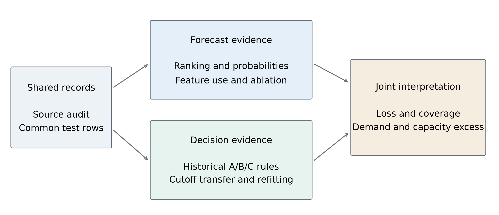

# From Forecast Evaluation to Warning Decisions: A Retrospective Study of Seismic Hazard in Underground Mining

Junjie Yang

Mining Engineering, Fuzhou University

## Abstract

Seismic warning rules can change their loss, coverage and workload on later records. We examine this transfer using complementary forecast and decision analyses on 2,063 common UCI Seismic Bumps test records with 88 hazardous-shift labels. Matching test records substantially narrows random-versus-record-order average precision (AP) differences, showing cohort sensitivity without isolating leakage or drift. We then select budget-only, cost-only and capacity-constrained cost rules on historical reference data and evaluate their frozen transfer. For fixed XGBoost models at an assumed missed-hazard cost ten times the false-alert cost, capacity-constrained cost rules show pooled loss differences of 0.00 to 0.82 units per 100 records against no alarms; intervals for the nonzero differences include zero. At a 20% historical budget, these rules produce 34 alerts and 2 detections, compared with 557 alerts and 25 detections for budget-only rules, among 88 hazardous shifts. Historical capacity feasibility does not ensure later feasibility, and refitting can change decisions at an unchanged cutoff. A separately specified exploratory comparison at matched grade allocations and test-batch slots does not establish a consistent detection increment from adding monitoring variables beyond grades and shift type. The findings support joint evaluation of loss, coverage and workload on overlapping records; recorded order remains a temporal proxy.

Keywords: seismic hazard; forecast evaluation; average precision; warning decisions; threshold transfer; inspection capacity

## 1 Introduction and research objective

Mine-monitoring scores become engineering decisions when a rule selects subsequent shifts for inspection. Historical loss minimization or capacity feasibility does not determine what the same rule will demand or detect on later records. This study asks: how do historically selected seismic warning rules perform on subsequent records in loss, hazardous-shift coverage and alarm workload, and what forecast-evaluation evidence supports interpreting those outcomes?

Two questions organize the analysis. First, how does evaluation on common test records change the apparent forecast-protocol gap? Second, how do loss, coverage and workload change when historical warning rules transfer under assumed costs and capacity? Calibration, TreeSHAP and refitted ablations provide supporting evidence about probabilities and model use of information. The earlier within-grade ranking pilot remains separate. A separately specified exploratory analysis complements threshold-transfer evaluation by asking whether monitoring variables improve detection when test-batch workload and grade allocations are held fixed. Its core result is included here, with full evidence in the exploratory supplement. The two stages retain their own fitting and threshold protocols; one is not a prospective validation of the other.

## 1.1 Relation to mining and decision research

The UCI task concerns a high-energy seismic bump in the next shift, rather than a confirmed rockburst accident [1]. Earlier rule-induction work used working-face-specific monitoring and examined rule transfer [2]. Janusz and colleagues compared expert and sensor information and studied cold start with identified mining sites and structured histories [3]. Those cohorts and forecast targets do not supply a directly comparable performance leaderboard for the present shift-summary mirror. The microseismic monitoring review distinguishes waveform detection and location from forecasting [4]. This study evaluates supplied shift summaries, not event detection from waveforms.

Threshold-choice theory relates scores, operating conditions and expected classification loss [5]. Risk-informed warning identification connects warnings to assessment and response, but its assessment-based Seismic Bumps comparison differs from this study's subsequent-shift event label [6]. Precision-recall interpretation also depends on the evaluation prevalence [7]. These sources motivate explicit comparators; they do not establish that a retrospectively selected rule will work at a new mine or future operating condition.

The evaluated models are logistic regression (LR), bagged classification and regression trees (CART), and XGBoost. The study contributes three connected elements. First, common-cohort forecast assessment quantifies how the apparent AP protocol gap changes with the evaluated records: the gaps shrink by 89.7% for LR, 86.9% for CART, 89.4% for XGBoost, without identifying a causal share of leakage or drift. Second, the decision analysis jointly measures transferred loss, detections, workload and capacity excess, explains historical no-alarm choices and compares fixed with refitted models. A matched-allocation supplement then asks whether monitoring information adds coverage beyond grades and shift type. Third, the implementation connects source row mappings, saved predictions, historical threshold candidates and row-level decisions to verification through separate calculation paths. This is an application and empirical evaluation of established learning, explanation, threshold-choice and resampling methods.

## 2 Data, target and common evaluation records

The official source contains 2,584 records and 170 positive shift labels. An ARFF-to-mirror audit reproduces first-occurrence deduplication without reordering: 6 exact duplicate occurrences, all negative, are removed to yield 2,578 mirror records [1,8]. This verifies the mirror transformation; it does not establish that identical monitoring records could not have represented distinct real shifts. A positive label denotes a bump above 10,000 J in the subsequent eight-hour shift. It is not a catalogue of independent accidents or a measured intervention benefit.

The retained 17-column design contains three hazard assessments (seismic, seismoacoustic, ghazard), four geophone variables, nine seismic-activity variables and shift type. The geophone deviations already use historical summaries supplied with the data. The total count nbumps is omitted from this design; constant energy-band columns remain. Neither timestamps nor working-face identifiers are available to validate cross-row continuity. Recorded order is therefore the stated temporal proxy, not a verified sequence of consecutive shifts from one working face.

Table 1. Shared test census and Stage 2 reference areas. The blocks are record-order evaluation groups, not identified mining sites.

| Record block | Test records | Test positives | Test prevalence | Reference records | Reference positives |
| --- | --- | --- | --- | --- | --- |
| 1 | 516 | 36 | 6.98% | 103 | 21 |
| 2 | 515 | 10 | 1.94% | 207 | 1 |
| 3 | 516 | 24 | 4.65% | 310 | 7 |
| 4 | 516 | 18 | 3.49% | 413 | 20 |

The common test cohort has 88/2063 positives (4.27%), distinct from the full-mirror prevalence of 6.59%. The 774-record holdout is wholly within the common test rows and uses a different training cutoff. It fits the first 1,804 mirror records (one-based rows 1-1,804) and tests the last 774 (rows 1,805-2,578). It was already inspected and is supplementary, overlapping evidence; it is neither an additional independent cohort nor an untouched confirmation set. Sample counts are not added across stages or protocols.

## 3 Two complementary evaluation protocols

LR uses balanced class weights and an L2 penalty of 1. The CART label denotes a bagged tree model with 60 unweighted bootstrap trees, depth 6 and minimum leaf size 20. XGBoost uses binary logistic loss, histogram trees, learning rate 0.05, minimum child weight 10 and L2 penalty 5 [9]. The grid is depths 2/3 crossed with 80/160 rounds, with seed 7, two threads and full row/column sampling. Tuning occurs within the supplied training area. Models have deliberately asymmetric weighting and tuning; these are comparisons of retained workflows, not equal-budget algorithm searches.

Table 2. Workflow definitions. Numerical cutoffs and alert counts are comparable only under matched workflows.

| Item | Forecast study (Stage 1) | Decision study (Stage 2) |
| --- | --- | --- |
| Main comparison | Random versus expanding record order on common test rows | Historical A/B/C rules transferred to the same later blocks |
| Model fitting | Outer models refit on supplied training rows | Primary fixed model fits first 80% of outer history |
| Policy reference | Last 20% of history; separate earlier reference model | Last 20% of history; scores from primary fixed model |
| XGBoost choice | Separate training-local searches for outer/reference models | Search inside fitting area; same chosen settings for refitted control |
| Budget cutoff | Exclude boundary score and all ties | Canonical whole-score groups; alerts score >= cutoff |
| Primary transfer | Reference cutoff applied after outer refitting | Freeze model and cutoff; refit on all history as a control |
| Probability scale | LR prior correction for probability evaluation; raw scores for alerts | Raw scores for fixed and refitted alert rules |

Stage 1 uses ten stratified random folds and five seeds; random predictions are restricted to the same 2,063 rows as record-order evaluation. Random AP is the mean of seed-specific AP values. Expanding-window fits train on earlier record blocks. Structured validation makes the tested population and information boundary explicit [10,11]. Matching test rows does not equalize training sizes or remove all protocol differences.

In Stage 2, the first 80% of each historical prefix is the fitting area and the remainder is the policy reference. XGBoost chooses parameters on a further 80/20 split inside the fitting area using AP, with negative Brier score if the inner reference has no positives. A separate refitted control adds the policy-reference rows to fitting, retains the selected parameters and applies the identical numerical threshold. Test labels enter evaluation, not model, parameter or cutoff selection. The Stage 2 plan was locked before its fits, after the dataset had already been examined in Stage 1; the complete study remains exploratory and retrospective.

## 3.1 Probability, explanation and decision definitions

AP is the sum of precision values weighted by recall increments, with tied scores evaluated as a group. Precision P and recall R are evaluated at successive distinct-score groups k, starting from zero recall. The horizontal PR reference is the evaluation cohort prevalence π [7]. AP-minus-pi is reported as a descriptive difference, not a permutation test or an interval estimate. It neither removes all differences between cohorts nor proves decision value. LR prior correction uses only each outer training fold's unweighted prevalence; CART and XGBoost use their fitted outputs.

$$
AP=\sum_k P_k(R_k-R_{k-1})
$$

Expected calibration error is the bin-count-weighted absolute difference between mean event probability and observed hazardous fraction [12,13]. The present binary event-probability definition uses up to ten quantile bins, collapses duplicate edges and keeps tied probabilities together. Guo and colleagues instead summarize predicted-class confidence and accuracy using equally spaced bins. Binning is an assessment step, not a calibration model fitted on test labels. Brier score (BS) is the binary event-probability mean squared error [14]; the named historical training-prior or retrospective test-prevalence predictor supplies its reference; skill is undefined when the reference error is zero.

$$
\mathrm{Brier\ skill}=1-\frac{BS_{\mathrm{model}}}{BS_{\mathrm{reference}}}
$$

Prior-only distribution change is a specific modeling assumption [15]. A probability correction is monotone within a fold; differing fold-specific corrections should not be assumed to preserve pooled rankings. Native exact TreeSHAP decomposes each XGBoost raw log-odds prediction into feature contributions and a bias term, using training leaf covers as its tree-path-dependent reference [16,17]. Refitted group ablations ask a different question: how predictions change after a model is trained without the group. They are not causal feature effects.

Cost-sensitive decisions use the hypothetical loss L = r FN + FP, with false-alert cost 1 [18]. Historical budgets are 1%, 5%, 10% and 20%; r takes 5, 10, 20 and 50. A maximizes whole-group alerts within floor(B Nref). B minimizes reference loss. C minimizes it among capacity-feasible groups. Ties in B/C loss select fewer alerts. Equal scores move together; nonempty partial sets use the lowest included score. No alarms use +infinity and all alarms use -infinity. These conventions can underfill capacity and do not impose later capacity.

An alert represents one candidate shift for inspection. TP is a hazardous shift flagged, FP a non-hazardous shift flagged and FN a hazardous shift missed. In the following equations, r is the assumed missed-hazard cost relative to false-alert cost 1, N is the evaluated record count, B is the historical capacity fraction and Ntest is the current test-block size. Loss and its difference from no alarms are:

$$
L_{100}=\frac{100(r\,FN+FP)}{N}
$$

$$
\Delta L_{\mathrm{none},100}=\frac{100(FP-r\,TP)}{N}
$$

Negative loss differences mean lower hypothetical loss. Capacity excess is calculated separately within each test block:

$$
\mathrm{Excess}=\max\{0,\mathrm{Alerts}-\lfloor BN_{\mathrm{test}}\rfloor\}
$$

All alerts remain in evaluation, including excess demand. No dispatch, truncation, queueing, separate true-positive inspection cost or accident-severity cost is modeled. Pooled excess sums record block excesses, without cancellation by spare slots elsewhere.

Paired moving-block intervals use 2,000 replicates and block length 32, separately within test record blocks, without wrapping across endpoints or record block boundaries [19,20]. Both compared methods use the same sampled rows; pooled sampling preserves record block sizes. Intervals condition on saved predictions, fitted rules and the current cohort, and exclude full fitting/tuning/selection uncertainty. The original contrasts cover C-A, C-B, secondary B-A and refitted-fixed. The separately specified supplement adds policy-minus-no-alarm and ML-minus-direct-grade contrasts; its rules, seeds and results are recorded separately. Intervals are unadjusted exploratory comparisons.

The direct-rule supplement thresholds seismic, seismoacoustic and ghazard separately on the original historical reference rows [1]. UCI explicitly defines seismic severity from a to d; all three ARFF domains use these codes. The common a<b<c<d ordering is the study's ordinal interpretation for the two other assessments, not a verified deployed policy. The mirror contains seismic codes a, b; the two other fields contain a, b and c, with no observed d. Each field uses the same A/B/C objectives, whole-grade ties and canonical thresholds as ML. Duplicate reference alert sets are collapsed: none uses +infinity, all uses -infinity, and partial sets use their minimum included observed grade. No best grade field is selected from test results. Saved ML scores, cutoffs and alerts are reused exactly; no model is retrained.

## 4 Forecast evidence on comparable test records

Table 3a. AP on 2,063 common test records; prevalence reference pi = 0.0427. AP-minus-pi concerns the record-order column.

| Model | Random AP | Record-order AP | AP minus pi | Random minus order | 95% paired interval |
| --- | --- | --- | --- | --- | --- |
| LR | 0.0953 | 0.0838 | 0.0412 | 0.0114 | [-0.0110, 0.0243] |
| CART | 0.0972 | 0.0784 | 0.0357 | 0.0188 | [0.0064, 0.0323] |
| XGBoost | 0.0995 | 0.0862 | 0.0436 | 0.0133 | [0.0004, 0.0256] |

Table 3b. Attenuation of the AP protocol gap after matching test records.

| Model | Different-cohort gap | Common-cohort gap | Attenuation |
| --- | --- | --- | --- |
| LR | 0.11141 | 0.01145 | 89.7% |
| CART | 0.14330 | 0.01876 | 86.9% |
| XGBoost | 0.12525 | 0.01328 | 89.4% |

The different-cohort gap compares random validation on 2,578 records with record-order validation on 2,063; the common-cohort gap evaluates both on the same 2,063 records. Attenuation = 1 - common-cohort gap / different-cohort gap, calculated before rounding. The record-order predictions and fitted random models are unchanged. Attenuation is descriptive cohort sensitivity, not a causal decomposition or a confidence interval.

The interval in Table 3a belongs to the protocol difference, not to AP-minus-pi. All common-cohort point AP values exceed the prevalence reference; that descriptive observation alone is not a significance test against a random-ranking null. Finite-sample random-order AP and the horizontal PR reference are distinct concepts. No global label permutation is introduced.

Restricting the comparison to common rows reduces the original different-cohort gap by 89.7% for LR, 86.9% for CART, 89.4% for XGBoost. The comparison changes which records contribute to the random score, not its fitted models. Cohort matching establishes evaluation-population sensitivity, while residual differences combine training history, sample size and tuning. Neither attenuation nor the residual is a causal estimate of leakage or drift. Table 3b makes the original and matched gaps directly comparable; the Stage 1 technical report retains the full protocol detail.

Record-block-specific XGBoost results further separate ranking from cohort composition: record block 1: AP 0.1341 at prevalence 0.0698; record block 2: AP 0.0284 at prevalence 0.0194; record block 3: AP 0.0731 at prevalence 0.0465; record block 4: AP 0.0618 at prevalence 0.0349. These are Stage 1 outer-model predictions, not Stage 2 fixed-model scores. The supplementary holdout overlaps these records and is not used to choose a model, subset or budget.

## 4.1 Probability improvement depends on the reference

Training-prior correction reduces LR ECE from 0.2904 to 0.0271 and Brier score from 0.1462 to 0.0439. This compares the same model outputs before and after the probability-scale correction. Brier skill asks whether the corrected forecasts improve on a separately defined reference, so the sign of skill can differ across references without contradicting improved ECE.

Table 4. Common-cohort probability references. LR is prior-corrected; CART and XGBoost retain raw probabilities.

| Model | Model Brier | Historical Brier | Historical skill | Retrospective Brier | Retrospective skill |
| --- | --- | --- | --- | --- | --- |
| LR | 0.0439 | 0.0455 | 0.0342 | 0.0408 | -0.0751 |
| CART | 0.0433 | 0.0455 | 0.0472 | 0.0408 | -0.0607 |
| XGBoost | 0.0429 | 0.0455 | 0.0573 | 0.0408 | -0.0494 |

The historical constant is deployable within each recorded protocol because it uses training labels only. The retrospective constant uses the evaluated prevalence for assessment and does not generate predictions. Stage 2 does not apply cost cutoffs to corrected LR probabilities: its A/B/C rules operate on raw reference scores. A calibration gain therefore does not constitute an observed reduction in Stage 2 warning loss.

## 4.2 Feature use and incremental predictive evidence

Table 5. Full design versus a refitted learner using all three hazard-rating fields.

| Model | Full AP | Ratings-only AP | Full minus ratings | 95% paired interval |
| --- | --- | --- | --- | --- |
| LR | 0.0838 | 0.0596 | 0.0243 | [-0.0039, 0.0619] |
| CART | 0.0784 | 0.0738 | 0.0046 | [-0.0252, 0.0264] |
| XGBoost | 0.0862 | 0.0766 | 0.0096 | [-0.0148, 0.0413] |

Ratings-only denotes a separately fitted LR, CART or XGBoost using seismic, seismoacoustic and ghazard together. It is not a direct grade-to-alarm rule or the mine's deployed practice. The paired gain intervals include zero under the retained configurations. XGBoost ablations reuse full-design training-selected parameters, so the contrasts are conditional design comparisons rather than equally retuned optima for every subset.

The leading contributions are energy, nbumps2, gpuls. Removing the seismic-activity group and refitting yields AP 0.1292 versus 0.0862 for the full design; the paired difference is 0.0430 with interval [-0.0034, 0.1067]. The interval includes zero. Large attribution and uncertain refitted benefit can coexist because they concern different models and questions. Correlated inputs, interactions and sampling variability are possible explanations, not identified causes. No subset is selected from these test results.

## 5 Warning loss, detections and inspection demand

Table 6. Stage 2 fixed XGBoost, r=10, pooled over 2,063 records. Negative loss differences favor the policy over no alarms.

| Rule | Budget | L100 | Delta vs none | TP | FN | FP | Alerts | Excess |
| --- | --- | --- | --- | --- | --- | --- | --- | --- |
| none | - | 42.66 | 0.00 | 0 | 88 | 0 | 0 | - |
| A | 1% | 45.52 | 2.86 | 0 | 88 | 59 | 59 | 39 |
| A | 5% | 45.90 | 3.25 | 9 | 79 | 157 | 166 | 81 |
| A | 10% | 47.21 | 4.56 | 14 | 74 | 234 | 248 | 84 |
| A | 20% | 56.33 | 13.67 | 25 | 63 | 532 | 557 | 227 |
| B | - | 44.06 | 1.41 | 35 | 53 | 379 | 414 | - |
| C | 1% | 42.66 | 0.00 | 0 | 88 | 0 | 0 | 0 |
| C | 5% | 43.33 | 0.68 | 1 | 87 | 24 | 25 | 0 |
| C | 10% | 43.48 | 0.82 | 1 | 87 | 27 | 28 | 0 |
| C | 20% | 43.24 | 0.58 | 2 | 86 | 32 | 34 | 0 |

The point loss of C equals the no-alarm comparator at 1% and is higher at the other three budgets. The new frozen-policy intervals below assess this particular contrast. Lower C loss than A is compatible with a higher loss than no alarms: reducing false alerts can lower assumed cost while also reducing detections.

At r=10 the block-specific C-minus-no-alarm loss ranges are record block 1: 0.00 to 2.13; record block 2: 0.00; record block 3: 0.00; record block 4: 0.00 to 1.16 units per 100 records. These ranges retain all four budgets; pooled findings are not attributed uniformly to every record block. Historical budgets constrain reference selection, so methods with the same budget can generate different later workloads.

For the 20% budget at r=10, pooled C-A changes detections from 25 to 2 and reduces excess demand by 227 alerts. The loss difference is -13.09 per 100 records. This is a measured workload-coverage tradeoff under the assumed loss, not a demonstrated safety improvement. Actual inspection execution and accident avoidance are not observed.

At r=10 and budget 20%, record block 1 C-A is 1.36 per 100 records, with paired 95% interval [-0.97, 5.43]. The interval contains zero.

At r=10 and budget 20%, record block 2 C-A is -36.50 per 100 records, with paired 95% interval [-49.13, -27.18]. The interval is entirely below zero.

## 5.1 Frozen policies compared with no alarms

Table 7. Frozen XGBoost C minus no alarms at r=10, per 100 records. Brackets are paired 95% intervals; negative favors C.

| Record block | Budget | Delta [95% interval] | TP | FN | Alerts |
| --- | --- | --- | --- | --- | --- |
| 1 | 1% | 0.00 [0.00, 0.00] | 0 | 36 | 0 |
| 1 | 5% | 1.55 [0.39, 3.10] | 0 | 36 | 8 |
| 1 | 10% | 2.13 [0.78, 4.07] | 0 | 36 | 11 |
| 1 | 20% | 1.16 [-3.88, 4.84] | 1 | 35 | 17 |
| 2 | 1%, 5%, 10%, 20% | 0.00 [0.00, 0.00] | 0 | 10 | 0 |
| 3 | 1%, 5%, 10%, 20% | 0.00 [0.00, 0.00] | 0 | 24 | 0 |
| 4 | 1% | 0.00 [0.00, 0.00] | 0 | 18 | 0 |
| 4 | 5%, 10%, 20% | 1.16 [-3.10, 4.46] | 1 | 17 | 17 |
| Pooled | 1% | 0.00 [0.00, 0.00] | 0 | 88 | 0 |
| Pooled | 5% | 0.68 [-0.34, 1.65] | 1 | 87 | 25 |
| Pooled | 10% | 0.82 [-0.19, 1.84] | 1 | 87 | 28 |
| Pooled | 20% | 0.58 [-1.02, 1.89] | 2 | 86 | 34 |

Comma-separated budgets share exactly the same aligned row-level decisions within that record block, not merely rounded loss or interval endpoints. The complete appendix retains each setting separately. C in record block 1 at 5% and 10% gives positive loss intervals and no detections; the nonzero pooled intervals cross zero. Record block and pooled evidence therefore support different loss-direction assessments. Where C produces no alerts, every row-level difference is zero and the interval is [0,0] by construction. This establishes identical observed decisions, not reliable transfer. No alarms detect no hazardous shifts and remain a loss comparator rather than an operating recommendation.

## 5.2 Direct hazard-grade comparators

Table 8. C rules at r=10 on the same pooled records. Reference selection is separate for each method; future workloads need not match.

| Budget | Method | Delta vs none [95%] | TP | FN | FP | Alerts | Excess |
| --- | --- | --- | --- | --- | --- | --- | --- |
| 1% | XGBoost | 0.00 [0.00, 0.00] | 0 | 88 | 0 | 0 | 0 |
| 5% | XGBoost | 0.68 [-0.34, 1.65] | 1 | 87 | 24 | 25 | 0 |
| 10% | XGBoost | 0.82 [-0.19, 1.84] | 1 | 87 | 27 | 28 | 0 |
| 20% | XGBoost | 0.58 [-1.02, 1.89] | 2 | 86 | 32 | 34 | 0 |
| 1%, 5%, 10%, 20% | seismic | 0.00 [0.00, 0.00] | 0 | 88 | 0 | 0 | 0, 0, 0, 0 |
| 1%, 5%, 10%, 20% | seismoacoustic | 0.00 [0.00, 0.00] | 0 | 88 | 0 | 0 | 0, 0, 0, 0 |
| 1%, 5%, 10%, 20% | ghazard | -0.87 [-3.97, 1.36] | 4 | 84 | 22 | 26 | 21, 1, 0, 0 |

Budgets are grouped only when their full transferred decision vectors match. Comma-separated excess counts follow the listed budget order: identical alarms can exceed different numbers of capacity slots. The appendix retains the ungrouped record block and pooled settings.

At r=10, seismic and seismoacoustic C select no alarms across the displayed budgets. The ghazard rules yield 26 alerts, 4 detections and 22 false alerts, with loss difference -0.87 [-3.97, 1.36] versus no alarms. Their repeated pooled counts reflect the same transferred decisions, not independent replications. The negative point difference does not establish loss improvement because its interval crosses zero. Coarse reference grade groups can underfill budgets; later frequencies can also exceed them.

Table 9. Frozen XGBoost minus each historically selected grade C rule at r=10. Brackets are paired 95% intervals; negative favors ML.

| Record block | Budget | ML minus seismic | ML minus seismoacoustic | ML minus ghazard |
| --- | --- | --- | --- | --- |
| 1 | 1% | 0.00 [0.00, 0.00] | 0.00 [0.00, 0.00] | 3.49 [-5.43, 16.09] |
| 1 | 5% | 1.55 [0.39, 3.10] | 1.55 [0.39, 3.10] | 5.04 [-4.07, 18.02] |
| 1 | 10% | 2.13 [0.78, 4.07] | 2.13 [0.78, 4.07] | 5.62 [-3.49, 18.99] |
| 1 | 20% | 1.16 [-3.88, 4.84] | 1.16 [-3.88, 4.84] | 4.65 [-3.49, 15.90] |
| 2 | 1%, 5%, 10%, 20% | 0.00 [0.00, 0.00] | 0.00 [0.00, 0.00] | 0.00 [0.00, 0.00] |
| 3 | 1%, 5%, 10%, 20% | 0.00 [0.00, 0.00] | 0.00 [0.00, 0.00] | 0.00 [0.00, 0.00] |
| 4 | 1% | 0.00 [0.00, 0.00] | 0.00 [0.00, 0.00] | 0.00 [0.00, 0.00] |
| 4 | 5%, 10%, 20% | 1.16 [-3.10, 4.46] | 1.16 [-3.10, 4.46] | 1.16 [-3.10, 4.46] |
| Pooled | 1% | 0.00 [0.00, 0.00] | 0.00 [0.00, 0.00] | 0.87 [-1.36, 3.97] |
| Pooled | 5% | 0.68 [-0.34, 1.65] | 0.68 [-0.34, 1.65] | 1.55 [-0.92, 5.04] |
| Pooled | 10% | 0.82 [-0.19, 1.84] | 0.82 [-0.19, 1.84] | 1.70 [-0.82, 5.19] |
| Pooled | 20% | 0.58 [-1.02, 1.89] | 0.58 [-1.02, 1.89] | 1.45 [-0.83, 4.65] |

All nondegenerate pooled C-minus-grade contrasts at the displayed cost include zero; identical decisions give exact zero contrasts. These C comparisons do not establish additional ML loss value over the direct grade rules. They also do not prove equivalence: the intervals retain both loss improvement and loss increase. The appendix retains A/B/C for every planned cost and budget, including per-block and pooled detections, workload, excess and paired contrasts. The direct rules differ from the jointly fitted ratings-only models in Table 5.

The selection mechanism changes the comparison. For cost-only B at r=10, pooled ML-minus-grade loss is -4.41 [-7.03, -0.97] for each grade field, with all three intervals below zero. In contrast, B-minus-no-alarm is 1.41 [-9.26, 11.05]. The cost-only rules applied separately to the three hazard-assessment fields make exactly the same row-level decisions: every record in block 1 is flagged and no record is flagged in blocks 2-4. Each gives 36 detections, 480 false alerts and 516 alerts; XGBoost gives 35, 379 and 414 respectively. The lower assumed loss therefore reflects 101 fewer false alerts at the cost of 1 fewer detection. These are three comparisons with the same final rule, not three distinct empirical confirmations. Lower loss than that rule does not establish lower loss than no alarms. These exploratory, unadjusted results are retained without selecting a new preferred workflow.

## 5.3 Historical selection explains capacity and no-alarm outcomes

Table 10. Fixed-XGBoost capacity excess and historical reasons for C no-alarm selection.

| Record block | A excess settings | C excess settings | Cost selects none | Capacity changes to none |
| --- | --- | --- | --- | --- |
| 1 | 1/4 | 0/16 | 0 | 4 |
| 2 | 4/4 | 0/16 | 16 | 0 |
| 3 | 4/4 | 0/16 | 12 | 4 |
| 4 | 4/4 | 2/16 | 0 | 4 |

All reference areas contain positive labels, yet 40 of the 64 C settings select no alarms. Of these, 28 follow unconstrained cost optima and 12 follow changes induced by the historical capacity restriction. These classifications use reference decisions, not test performance. A small reference advantage over another feasible alarm set describes a weak selection margin; it does not by itself establish unstable thresholds.

The budget rule exceeds later capacity in 13/16 block-budget settings and C in 2/64 block-budget-cost settings. The settings are dependent and use different denominators. In record block 2, A at a 20% budget produces 254 alerts, with 151 above its 103 later slots. The reference budget had been feasible. Different reference/test prevalences, including only one positive among 207 reference records in record block 2, provide context but do not identify prevalence shift as the sole cause; class-conditional scores can also change. Batch Top-k enforces capacity within the complete observed score batch and remains a retrospective ranking reference, not a real-time rule or performance bound.

On the reference area, C cannot have lower optimized loss than B because its candidate set is a subset. That ordering need not survive transfer. Whole-tie rules and fixed numerical cutoffs explain how historical feasibility can coexist with both later underuse and excess demand.

## 5.4 Model updating at a frozen numerical cutoff

Table 11. XGBoost refitted-minus-fixed changes. Finite groups are defined by historical selection.

| Rule | Finite | No alarm | All alarm | Finite Delta L100 | Finite Delta alerts |
| --- | --- | --- | --- | --- | --- |
| A | 16 | 0 | 0 | -18.83 to 18.22 | -97 to 82 |
| B | 9 | 7 | 0 | -17.64 to 18.80 | -25 to 119 |
| C | 24 | 40 | 0 | -11.05 to 7.75 | -11 to 2 |

Distinct historical settings count record block times budget for A, record block times cost for B, and record block times budget times cost for C. A is reused when evaluating costs. The ranges retain all stated evaluation costs. Refitting can alter both the fitted function and raw-score scale; using the same cutoff measures their combined workflow difference, not a causal effect of either component. Infinite cutoffs are invariant by construction and provide no evidence of finite-cutoff robustness.

For a specific finite cutoff, record block 1 A at budget 20% and r=10 uses 0.385854 in both workflows. Alerts change from 21 fixed to 7 refitted; detections change from 2 to 0. Refitted-minus-fixed loss is 1.55 per 100 records, with paired 95% interval [-2.52, 7.17]. This interval concerns model updating, separately from the C-A policy intervals in Section 5.

The retained block intervals are descriptive and unadjusted across settings. They characterize uncertainty in differences among frozen decisions on the observed queue of records. LR and bagged CART supply additional model comparisons under the same reference boundaries; they do not certify robustness across mines, future distributions or untested model classes. Complete per-block results and all costs remain in the Stage 2 technical report and saved files.

## 5.5 Frozen-rule cost and prevalence descriptions

Table 12. Cost equality for unchanged pooled C rules selected historically at rselect=10.

| Historical budget | TP | FP | Alerts | Equality cost r* |
| --- | --- | --- | --- | --- |
| 1% | 0 | 0 | 0 | - |
| 5% | 1 | 24 | 25 | 24.00 |
| 10% | 1 | 27 | 28 | 27.00 |
| 20% | 2 | 32 | 34 | 16.00 |

For a frozen alert set with at least one true detection, the evaluation-cost equality point with no alarms is:

$$
r^{*}=\frac{FP}{TP}
$$

Above this ratio the observed point loss favors the unchanged rule. TP=FP=0 is equivalent to no alarms for every cost; with TP=0 and FP>0 the rule has higher loss at every cost. The dash identifies no-alarm equivalence. These are descriptive equality points on this cohort, not cost estimates or test-selected recommendations.

Table 13. Frozen prevalence scenarios for C selected at r=10. Loss differences are versus no alarms; alerts and precision are expectations.

| Budget | pi 5% Delta | Alerts | Precision | pi 10% Delta | Alerts | Precision |
| --- | --- | --- | --- | --- | --- | --- |
| 1% | 0.00 | 0.00% | NA | 0.00 | 0.00% | NA |
| 5% | 0.59 | 1.21% | 4.69% | -0.04 | 1.21% | 9.41% |
| 10% | 0.73 | 1.36% | 4.19% | 0.09 | 1.34% | 8.45% |
| 20% | 0.40 | 1.65% | 6.88% | -0.81 | 1.69% | 13.48% |

The full supplement retains prevalences 2%, 5%, 10% and 15%. The compact display pairs loss and workload at 5% and 10% without reselecting policies. Under unchanged within-class rates, π denotes the scenario hazardous fraction, TPR and FNR are the detection and miss fractions among hazardous records, and FPR is the false-alert fraction among non-hazardous records. Expected loss and alert fraction A are:

$$
L_{100}(\pi)=100[r\pi\,FNR+(1-\pi)FPR]
$$

$$
A(\pi)=\pi\,TPR+(1-\pi)FPR
$$

$$
\mathrm{Precision}(\pi)=\frac{\pi\,TPR}{A(\pi)}
$$

Scenario precision is undefined at zero expected alerts (NA); observed zero-alert precision retains its existing zero convention. These scenarios neither diagnose actual shift nor estimate the probability of exceeding capacity.

## 5.6 Monitoring information at matched grades and slots

Historical threshold transfer changes both detection and workload. This supplement holds workload and grade allocation fixed to ask how much additional hazardous-shift coverage the monitoring variables supply. The four-input baseline contains seismic, seismoacoustic, ghazard and shift type; the extended design uses the retained 17 columns. Both use XGBoost, the same four historical fitting/test splits and the same inner AP search, tuned separately for each design. Neither policy-reference labels nor test labels enter fitting or tuning. The two designs therefore receive matched tuning opportunities, unlike the earlier ratings-only ablation that omits shift type.

Within each test block, the following K slots are allocated to higher seismic grades first and then to higher model scores within each grade. Both models receive identical total and grade-specific slots. A partially selected boundary tie is allocated uniformly: h slots among m tied records containing p hazardous labels contribute the boundary expectation below. The total adds TP from all fully selected grade-score groups. If no group is partially selected, the boundary contribution is zero. Pooled total expectations sum the block totals. Labels evaluate the allocation and do not determine it; decimal counts are expectations over tie allocation. Each of the 2,000 paired block-bootstrap draws reranks its sampled multiset and recomputes the slots and ties. Length 32 is primary; lengths 16 and 64 and the complete table remain in the supplement. These conditional intervals freeze model fits and tuning and do not cover their uncertainty.

$$
K=\lfloor BN_{\mathrm{test}}\rfloor
$$

$$
E(TP_{\mathrm{boundary}})=\frac{hp}{m}
$$

$$
E(TP_{\mathrm{total}})=TP_{\mathrm{fully\ selected}}+E(TP_{\mathrm{boundary}})
$$

At 20% test-batch slots, the pooled baseline has 30.71 expected total detections and the extended design 32.00, each using 412 slots. The difference is 1.29 with conditional 95% interval [-5.48, 7.05]. All 16 block-specific primary intervals and all four pooled intervals include zero; the point differences vary across blocks. This workflow has not established a consistent monitoring-information increment, and it does not establish that monitoring information is generally uninformative.

At fixed hazardous count P and allocated slots K, expected loss uses the total expected detections; a separate cost grid would restate this contrast:

$$
E(L)=rP+K-(r+1)E(TP_{\mathrm{total}})
$$

The two uses of 20% answer different questions. Historical C at r=10 produces 34 test alerts and 2 detections, whereas this batch study allocates 412 slots to each model. Its 32.00 expected detections cannot be compared with C as an improvement at equal workload. The batch task is retrospective ranking, not observed dispatch. Its protocol was specified after these test records had been examined; the records overlap the two stages and add no independent validation cohort.

[Exploratory supplement: matched design, all intervals and reproduction details](https://github.com/junjie-yang11/seismic-bump-forecasting/blob/manuscript-2026-10-26/reports/information/monitoring_information_increment.pdf)

[Supplementary decision combinations and threshold evidence](https://github.com/junjie-yang11/seismic-bump-forecasting/blob/manuscript-2026-10-26/reports/overall/decision_comparison_supplement.pdf)

## 6 Integrated interpretation and next evidence

Common-cohort comparisons establish protocol-gap sensitivity, probability correction concerns a named error reference, and feature attribution concerns fitted-model use. These supporting analyses distinguish the forecast evidence needed to interpret subsequent warning decisions.

Decision evaluation adds information that ranking, probability assessment and attribution do not supply. At the displayed cost, C can lower loss and inspection demand relative to A while having no favorable pooled point difference against no alarms. Historical capacity choices explain why rules are silent or active, whereas later counts show their transferred coverage and workload. Refitting changes which score function is subjected to a historical cutoff. These comparisons establish workflow-specific tradeoffs; they do not identify a universally preferred policy.

Block-specific evidence must accompany the pooled comparison. In record block 1, C at 5% and 10% has no detections and loss-difference intervals entirely above zero. The nonzero pooled intervals cross zero. Pooling therefore does not describe every record block, and an unresolved pooled direction does not erase a resolved increase within the stated record block and conditional analysis.

The shared cohort is also the main inference boundary. Recorded order supplies no verified timestamps or longwall continuity. Deduplication reproduces a public mirror, not a certified operational history. Costs, capacity slots and the absence of an excess-demand penalty are explicit scenario assumptions. The target counts hazardous shifts, not accidents, executed inspections or interventions. Two analyses of the same observed records increase explanatory coverage, not the number of independent validation cohorts.

Additional direct-grade and no-alarm contrasts show that decision value depends on the comparator: cost-only XGBoost has lower loss than the identical grade-rule decisions at r=10, while its no-alarm interval spans zero. The matched-information analysis fixes workload and does not establish a consistent monitoring increment beyond grades and shift type. Full refit/reselection uncertainty requires a separate protocol; credible lag features require verified continuity. Independent-site and inspection outcomes are the next evidence needed.

## 7 Conclusions

Comparable-cohort evaluation reduces the original AP gaps by 89.7% for LR, 86.9% for CART, 89.4% for XGBoost; this quantifies cohort sensitivity, not leakage or drift attribution. At r=10 and a 20% historical budget, capacity-constrained cost rules produce 34 alerts and 2/88 detections, versus 557 alerts and 25/88 for budget-only rules. C in record block 1 at 5% and 10% has no detections and positive loss-difference intervals; the nonzero pooled C intervals span zero. Joint loss, detection and workload accounting shows why historical optimality and capacity feasibility do not establish later decision value.

Fixing grade allocations and test-batch slots provides a different comparison: at 20%, monitoring inputs add 1.29 expected detections to a grade-plus-shift model, with conditional interval [-5.48, 7.05] and 412 slots per model. The block-specific evidence does not establish a consistent increment. Historical threshold transfer and equal-slot batch ranking should therefore remain distinct when interpreting decision value. Independent timestamped working-face data with inspection outcomes are needed to test transfer beyond this cohort.

## Data, code, contributions and AI assistance

The repository retains source mapping, predictions, historical candidates, row-level decisions, resampling outputs and version-specific checks. The reporting guide documents generation and verification; both stage papers provide technical detail. Code and evidence: https://github.com/junjie-yang11/seismic-bump-forecasting.

The author directed scope, protocol refinement and review priorities. ChatGPT and Codex substantially assisted implementation, execution, computational and reference checks, and writing. CONTRIBUTIONS.md documents these roles. AI-assisted writing workflows do not supply scientific evidence for the research conclusions.

## References

[1] Sikora M, Wrobel L. Seismic Bumps [Dataset]. UCI Machine Learning Repository, 2010. DOI: 10.24432/C5W902. https://archive.ics.uci.edu/dataset/266/seismic+bumps

[2] Sikora M, Wrobel L. Application of rule induction algorithms for analysis of data collected by seismic hazard monitoring systems in coal mines. Archives of Mining Sciences, 2010, 55(1):91-114. Author-linked full text: https://www.researchgate.net/publication/281395657

[3] Janusz A, Grzegorowski M, Michalak M, Wrobel L, Sikora M, Slezak D. Predicting seismic events in coal mines based on underground sensor measurements. Engineering Applications of Artificial Intelligence, 2017, 64:83-94. DOI: 10.1016/j.engappai.2017.06.002.

[4] Anikiev D, Birnie C, Waheed Ub, Alkhalifah T, Gu C, Verschuur DJ, Eisner L. Machine learning in microseismic monitoring. Earth-Science Reviews, 2023, 239:104371. DOI: 10.1016/j.earscirev.2023.104371.

[5] Hernández-Orallo J, Flach P, Ferri C. A Unified View of Performance Metrics: Translating Threshold Choice into Expected Classification Loss. Journal of Machine Learning Research, 2012, 13:2813-2869. https://jmlr.org/papers/v13/hernandez-orallo12a.html

[6] Spahic R, Hepsø V, Lundteigen MA. A Novel Warning Identification Framework for Risk-Informed Anomaly Detection. Journal of Intelligent & Robotic Systems, 2023, 108:17. DOI: 10.1007/s10846-023-01887-2.

[7] Saito T, Rehmsmeier M. The Precision-Recall Plot Is More Informative than the ROC Plot When Evaluating Binary Classifiers on Imbalanced Datasets. PLOS ONE, 2015, 10(3):e0118432. DOI: 10.1371/journal.pone.0118432.

[8] datasets/seismic-bumps. CSV mirror and preparation description. https://github.com/datasets/seismic-bumps

[9] Chen T, Guestrin C. XGBoost: A Scalable Tree Boosting System. Proceedings of KDD, 2016, 785-794. DOI: 10.1145/2939672.2939785.

[10] Bergmeir C, Benitez JM. On the use of cross-validation for time series predictor evaluation. Information Sciences, 2012, 191:192-213. DOI: 10.1016/j.ins.2011.12.028.

[11] Roberts DR et al. Cross-validation strategies for data with temporal, spatial, hierarchical, or phylogenetic structure. Ecography, 2017, 40:913-929. DOI: 10.1111/ecog.02881.

[12] Pakdaman Naeini M, Cooper G, Hauskrecht M. Obtaining Well Calibrated Probabilities Using Bayesian Binning. Proceedings of the AAAI Conference on Artificial Intelligence, 2015, 29(1). DOI: 10.1609/aaai.v29i1.9602.

[13] Guo C, Pleiss G, Sun Y, Weinberger KQ. On Calibration of Modern Neural Networks. Proceedings of ICML, PMLR 70, 2017:1321-1330. https://proceedings.mlr.press/v70/guo17a.html

[14] Brier GW. Verification of Forecasts Expressed in Terms of Probability. Monthly Weather Review, 1950, 78(1):1-3. DOI: 10.1175/1520-0493(1950)078<0001:VOFEIT>2.0.CO;2.

[15] Lipton ZC, Wang YX, Smola AJ. Detecting and Correcting for Label Shift with Black Box Predictors. Proceedings of ICML, PMLR 80, 2018:3122-3130. https://proceedings.mlr.press/v80/lipton18a.html

[16] Lundberg SM et al. From local explanations to global understanding with explainable AI for trees. Nature Machine Intelligence, 2020, 2:56-67. DOI: 10.1038/s42256-019-0138-9.

[17] XGBoost documentation. Booster.predict and exact feature contributions. https://xgboost.readthedocs.io/en/stable/python/python_api.html

[18] Elkan C. The Foundations of Cost-Sensitive Learning. Proceedings of IJCAI, 2001:973-978. Author manuscript: https://cseweb.ucsd.edu/~elkan/rescale.pdf

[19] Shalizi CR. Simulation for Inference I: The Bootstrap. Carnegie Mellon University course notes, 2018. https://stat.cmu.edu/~cshalizi/dst/18/lectures/18/lecture-18.html

[20] Künsch HR. The Jackknife and the Bootstrap for General Stationary Observations. The Annals of Statistics, 1989, 17(3):1217-1241. DOI: 10.1214/aos/1176347265.
